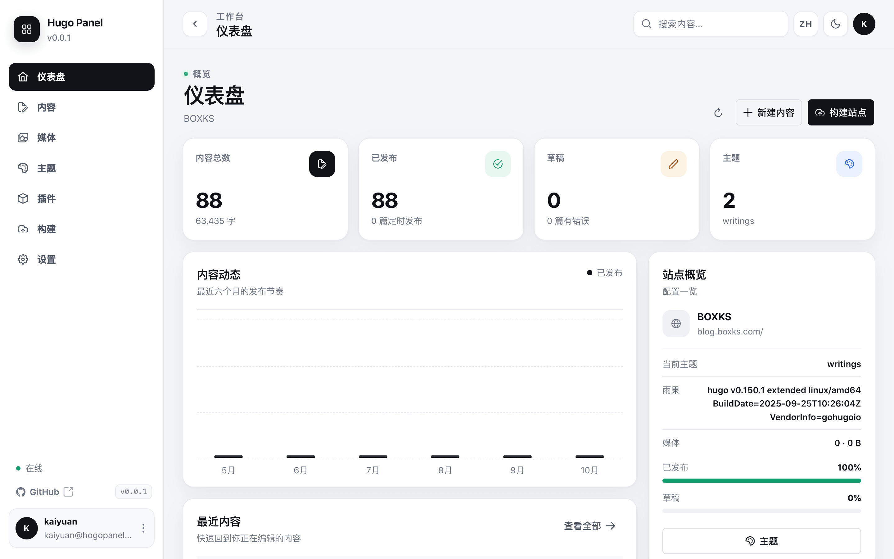
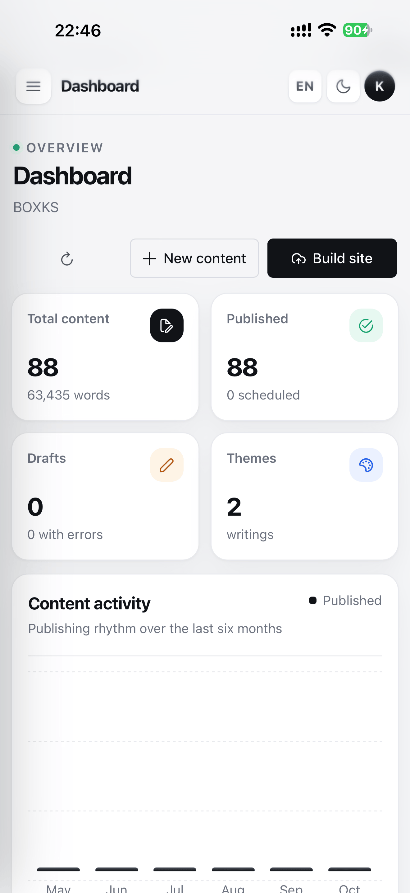

# Hugo Panel

一个用 Go 编写的 Hugo 站点管理后台。内容、主题、模块、媒体和构建都在一个界面里完成，不需要手写配置文件。前端使用 Vue 3 + PrimeVue，以静态资源形式由 Go 直接提供。


## 预览

| 桌面端 | 移动端 |
| --- | --- |
|  | |

介绍页（纯静态，由 GitHub Pages 托管）：<https://kaiyuan.github.io/hugo-panel/>

## 功能

- **首次启动向导**：创建管理员账户，密码使用 bcrypt 存储。
- **内容管理**：Markdown 页面/文章的新建、编辑、重命名、删除、搜索、筛选和分页；YAML / TOML / JSON front matter；标签、分类、草稿、定时发布和自定义字段；Markdown 实时预览。
- **主题管理**：列出 `themes/` 下的主题，启用主题，从 Git 安装、更新、移除主题；可视化编辑站点配置、主题参数和菜单。
- **插件管理**：以 Hugo Modules 方式安装/移除插件，执行 `hugo mod tidy`，并显示命令输出与工具链状态。
- **媒体库**：支持本机目录、S3（含 MinIO 等兼容服务）和 WebDAV 存储库；按文件夹浏览、上传、预览、复制 URL / Markdown、移动、复制和删除。可预览图片、视频、音频、PDF 与文本，其他文档可直接下载；编辑器内可打开媒体选择器插入 URL 或 Markdown。
- **构建**：在面板中运行 `hugo --gc --minify --cleanDestinationDir`，保留最后一次构建结果；构建失败时可邮件通知管理员。
- **SMTP**：首次启动后可在设置页配置，也可通过 Docker 环境变量注入；支持密码重置邮件和测试邮件。
- **多语言**：内置简体中文、繁体中文、英语、法语、意大利语、西班牙语、日语、韩语、德语。每种语言是独立 JSON 文件，按需加载；支持上传自定义翻译，无需重新构建。
- **亮色 / 暗色主题**：暗色主题使用纯黑 `#000` 背景，适合 OLED 屏幕；默认跟随系统。
- **PWA**：可安装到桌面/手机，包含离线应用壳与移动端适配。除 `localhost` 外，安装与 Service Worker 需要 HTTPS。
- **安全**：SQLite 持久化、HttpOnly 会话、CSRF 防护、登录/找回密码限流、同源校验、CSP、安全响应头、路径穿越防护、配置自动备份。

## Docker 部署（推荐）

镜像地址：`https://hub.docker.com/r/kaiyuan/hugo-panel`

```bash
docker run -d \
  --name hugo-panel \
  --restart unless-stopped \
  -p 8080:8080 \
  -v /srv/hugo-panel/data:/app/hugo-panel/data \
  -v /srv/my-hugo-site:/app/hugo \
  -e PUBLIC_URL=https://panel.example.com \
  -e TZ=Asia/Shanghai \
  kaiyuan/hugo-panel:latest
```

然后打开 `http://服务器地址:8080`，按向导创建管理员。

### Docker Compose

仓库内的 [`docker-compose.yml`](./docker-compose.yml) 使用本地源码构建镜像，不依赖远程镜像：

```yaml
services:
  hugo-panel:
    build: .
    image: hugo-panel:local
    restart: unless-stopped
    ports:
      - "8080:8080"
    environment:
      HUGO_DIR: /app/hugo
      PUBLIC_URL: https://panel.example.com
    volumes:
      - "${HOST_DATA_DIR:-./data}:/app/hugo-panel/data"
      - "${HOST_HUGO_DIR:-./hugo}:/app/hugo"
```

挂载目录通过 `.env` 配置，未设置时使用默认相对路径：

```dotenv
HOST_DATA_DIR=./data
HOST_HUGO_DIR=./hugo
```

```bash
docker compose up -d --build
```

SMTP 环境变量是可选的，不配置也能正常构建和启动；可在首次启动后到设置页配置。

### 目录约定

| 路径 | 用途 |
| --- | --- |
| `/app/hugo-panel` | 面板工作目录 |
| `/app/hugo-panel/data` | SQLite 数据库、备份、自定义翻译、Hugo/Go 缓存（建议持久化） |
| `/app/hugo` | Hugo 站点目录（默认值，可在设置页修改） |
| `/app/hugo/content` | 内容目录 |
| `/app/hugo/themes` | 本地主题 |
| `/app/hugo/static/images` | 内置媒体库（可在媒体页切换或新增存储库） |
| `/app/hugo/public` | 构建输出 |

容器默认以 UID/GID `1000` 运行，并在启动时把挂载目录 chown 给该用户。若由外部工具管理权限：

```bash
-e CHOWN_HUGO=false -e CHOWN_DATA=false
```

### 环境变量

| 变量 | 默认值 | 说明 |
| --- | --- | --- |
| `PORT` | `8080` | 监听端口 |
| `DATA_DIR` | `./data`（镜像内 `/app/hugo-panel/data`） | 数据目录 |
| `HUGO_DIR` | `./hugo`（镜像内 `/app/hugo`） | 首次启动写入设置的 Hugo 站点目录 |
| `HUGO_BINARY` | `hugo` | 首次启动写入设置的 Hugo 可执行文件 |
| `PUBLIC_URL` | 空 | 面板公网地址，用于密码重置链接；设置后环境变量优先 |
| `COOKIE_SECURE` | `auto` | `auto` / `true` / `false`，HTTPS 反代建议保持 auto |
| `LOG_LEVEL` | `info` | `debug` / `info` / `warn` / `error` |
| `SMTP_ENABLED` | 空 | `true` 开启 SMTP |
| `SMTP_HOST` | 空 | SMTP 主机 |
| `SMTP_PORT` | `587` | SMTP 端口 |
| `SMTP_USERNAME` | 空 | SMTP 用户名 |
| `SMTP_PASSWORD` | 空 | SMTP 密码 |
| `SMTP_FROM` | 空 | 发件地址 |
| `SMTP_FROM_NAME` | `Hugo Panel` | 发件人名称 |
| `SMTP_SECURITY` | `starttls` | `starttls` / `tls` / `none` |
| `CHOWN_DATA` | `true` | 启动时 chown 数据目录 |
| `CHOWN_HUGO` | `true` | 启动时 chown Hugo 目录 |

通过环境变量设置的 SMTP 值会优先于数据库设置，面板中会显示 `ENV` 标记并锁定对应字段。

## 开发

需要 Go 1.24+、GCC（SQLite 驱动使用 CGO）以及可选的 Hugo。无需 Node.js。

```bash
git clone https://github.com/Kaiyuan/hugo-panel.git
cd hugo-panel
mkdir -p data hugo

CGO_ENABLED=1 \
  DATA_DIR=./data \
  HUGO_DIR=./hugo \
  go run ./cmd/hugo-panel
```

或：

```bash
make run      # 本地运行
make test     # Go 测试
make vet      # go vet
make build    # 输出 bin/hugo-panel
```

前端文件位于 `web/static`，Vue/PrimeVue 等依赖已经以本地静态资源形式内置在 `web/static/vendor`，不经过打包器。

## 自定义翻译

内置翻译位于 `web/locales/*.json`。运行时自定义翻译放在数据目录：

```text
${DATA_DIR}/locales/pt-BR.json
```

文件是扁平的 `key: value` JSON，可参考 `en.json` 模板：

```json
{
  "_name": "Português (Brasil)",
  "_native_name": "Português (Brasil)",
  "nav.dashboard": "Painel",
  "common.cancel": "Cancelar"
}
```

也可以在 **设置 → 语言 → 添加翻译** 中上传 JSON 文件。缺失的键会自动回退到英文；新增语言无需重新编译或重启。

## 媒体存储

媒体页默认使用 Hugo 站点内的 `static/images`，也可以通过 **媒体 → 存储库设置** 添加更多存储库：

- **本机目录**：服务器上的绝对路径。适合挂载 NFS、对象存储网关或已有素材目录。
- **S3**：AWS S3、MinIO、Cloudflare R2、Backblaze B2 等兼容服务。支持自定义 endpoint、region、bucket、前缀和 path-style 访问。
- **WebDAV**：Nextcloud、ownCloud、群晖等 WebDAV 服务，使用 Basic Auth。

文件 URL 由 **公开访问基础 URL + 文件夹路径** 生成。例如基础 URL 为 `https://cdn.example.com/media`，文件位于 `posts/2026/photo.jpg`，复制出的 URL 就是 `https://cdn.example.com/media/posts/2026/photo.jpg`。留空时使用存储端点本身，或对内置库使用站点的 `/images/...` 路径。

上传大小上限按存储库单独设置（默认 512 MB）。反向代理（如 Nginx `client_max_body_size`）和存储服务商可能施加更低的限制。S3 密钥和 WebDAV 密码只保存在 SQLite 中，接口不会回传明文；编辑时留空表示保留原值。若 NAS 或自建服务使用自签名证书，可在该存储库中开启「允许自签名证书」；保存前可以点「测试连接」验证 URL、账号和证书。

所有存储库都提供统一的文件操作：新建文件夹、上传、预览、复制 URL / Markdown、移动、复制和删除。移动 / 复制可以在不同存储库之间进行；跨库操作会先下载到数据目录的临时文件再上传。

### 容器内解析不到 NAS 主机名

如果「测试连接」返回类似 `lookup nas.example.com on 127.0.0.11:53: i/o timeout`，说明 Docker 内置 DNS 没能解析该主机名，而不是账号或 WebDAV 配置错误。

先在宿主机确认主机名对应的 IP：

```bash
getent hosts nas.example.com
```

最省事的方式是在存储库设置里填写 **主机 IP**：面板会直接连接这个 IP，不再做 DNS 查询，但 HTTPS 证书校验和 `Host` 头仍然使用原来的主机名。这适用于 Docker 内置 DNS 超时、或域名只有宿主机能解析的情况。

如果已经在 compose 里配置了 `dns:`（例如 `1.1.1.1`）仍然超时，说明容器到这些 DNS 的出站 53 端口被阻断；删掉 `dns:` 让 Docker 使用宿主机的解析器，或改成实际能解析该域名的内网 DNS。

如果容器完全无法访问任何 53 端口（换成 `1.1.1.1`、`8.8.8.8` 也超时），可以在存储库设置里填写 **DNS over HTTPS**，例如 `https://1.1.1.1/dns-query`。面板会通过 443 端口解析存储服务器的主机名，再连接解析出的 IP，同时保留原 `Host` 头和 TLS SNI。请尽量使用基于 IP 的 DoH 地址，避免解析 DoH 服务器本身又依赖已经失效的 DNS；该地址必须能从容器直接访问。如果 `1.1.1.1` 不可达，可以换成其他可访问的 DoH 服务，例如阿里 DNS 的 `https://223.5.5.5/dns-query`。「主机 IP」和 DoH 同时填写时以「主机 IP」为准。

也可以在 Docker 层解决。`docker-compose.yml`：

```yaml
services:
  hugo-panel:
    extra_hosts:
      - "nas.example.com:192.168.2.10"
```

或者让容器使用能解析该域名的 DNS（路由器、AdGuard、内网 DNS 等）：

```yaml
services:
  hugo-panel:
    dns:
      - 192.168.2.1
```

`docker run` 对应参数是 `--add-host nas.example.com:192.168.2.10` 和 `--dns 192.168.2.1`。修改后执行 `docker compose up -d`，并在容器内验证：

```bash
docker exec -it hugo-panel getent hosts nas.example.com
```

如果域名本身解析正常，但 WebDAV 使用自签名 HTTPS 证书，还需要在存储库设置里打开「允许自签名证书」。

<!-- ## 发布

推送形如 `v1.2.3` 的 tag（或在 GitHub 上发布 Release，它会创建对应的 tag）会触发 [`.github/workflows/release.yml`](./.github/workflows/release.yml)，构建 `linux/amd64` 与 `linux/arm64` 镜像并推送到 Docker Hub：

- `kaiyuan/hugo-panel:1.2.3`
- `kaiyuan/hugo-panel:1.2`
- `kaiyuan/hugo-panel:latest`

需要在仓库 Secrets 中配置：

- `DOCKERHUB_USERNAME`
- `DOCKERHUB_TOKEN`

CI（`ci.yml`）只在 push/PR 时运行 `go vet`、`go test -race` 和二进制构建，不构建任何 Docker 镜像；镜像只由 tag 触发。 -->

## 架构

```text
cmd/hugo-panel          Go 入口、HTTP 服务、优雅退出
internal/config         环境变量配置
internal/store          SQLite、用户、会话、设置、密码重置
internal/settings       设置与环境变量覆盖
internal/hugo           内容、front matter、配置、主题、模块、构建
internal/media          媒体存储库（本机目录、S3、WebDAV）与文件操作
internal/mailer         SMTP、密码重置/构建失败邮件
internal/i18n           语言发现、按需加载、自定义翻译
internal/server         路由、鉴权、CSRF、安全头、API
web/static              Vue 3 + PrimeVue 单页应用、PWA、内置依赖
web/locales             9 种内置语言
```

数据库为单文件 SQLite（WAL 模式），配置/内容写入采用临时文件 + 原子重命名，修改前会备份到 `data/backups/`。

## 安全建议

- 生产环境使用 HTTPS 反向代理，并务必设置 `PUBLIC_URL`。未设置时，密码重置链接会从当前请求推断地址。
- 不要把数据目录或 Hugo 站点目录暴露为静态文件目录。
- 使用强密码；面板默认只允许创建第一个管理员，之后通过密码重置流程恢复访问。
- 若不需要 Hugo Modules，可自行移除运行时镜像中的 Go 包以减小体积。

## License

[MIT](./LICENSE)

前端第三方静态依赖及其许可证见 [THIRD_PARTY_LICENSES.md](./THIRD_PARTY_LICENSES.md)。
