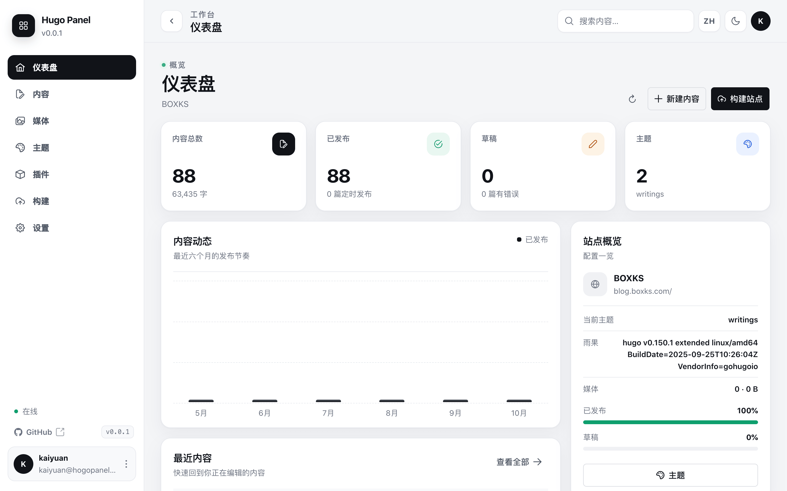
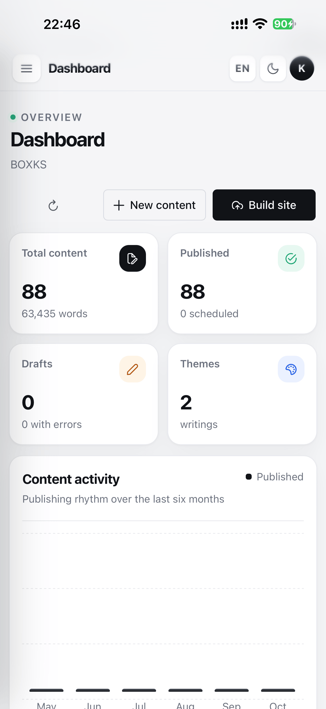

# Hugo Panel

English | [简体中文](./README_cn.md)


An admin panel for Hugo sites written in Go. Manage content, themes, modules, media and builds in one interface without hand-editing config files. The frontend uses Vue 3 + PrimeVue and is served directly by Go as static assets.


## Preview

| Desktop | Mobile |
| --- | --- |
|  | |

Landing page (static, hosted on GitHub Pages): <https://kaiyuan.github.io/hugo-panel/>

Full installation and usage guide: <https://kaiyuan.github.io/hugo-panel/guide.html>

## Features

- **First-run setup wizard**: Create the administrator account; passwords are stored with bcrypt.
- **Content management**: Create, edit, rename, delete, search, filter and paginate Markdown pages and posts; YAML / TOML / JSON front matter; tags, categories, drafts, scheduled publishing and custom fields; live Markdown preview. The editor includes a formatting toolbar, Markdown syntax highlighting, media insertion and cover selection from the media library; file paths are chosen from `content/` subdirectories and new folders can be created directly in the dropdown (including nested paths such as `posts/2026`). Titles can be translated into English filenames with one click, and empty URLs are generated from the directory and filename.
- **Title translation**: The editor's “English” button turns a post title into an English filename using LibreTranslate, DeepL or an OpenAI-compatible AI service. Keys are stored only on the server. When no service is configured or a request fails, a local rule-based name is generated; titles written entirely in Chinese fall back to a date-based filename.
- **AI writing assistant**: Connect any OpenAI-compatible chat completions service under **Settings → AI** (OpenAI, DeepSeek, Moonshot, Qwen, SiliconFlow, OpenRouter, Ollama, LM Studio, and others). The editor's AI button can polish, continue, summarize or run custom instructions, with a preview before applying the result. When no dedicated translation service is configured, the AI is also used to generate English filenames. Post content is sent to the configured provider.
- **Theme management**: List themes under `themes/`, activate a theme, and install, update or remove themes from Git; edit site configuration, theme parameters and menus visually. Split configuration under `config/_default/` is supported, and custom theme parameters from files such as `params.toml` are listed together with other non-standard top-level settings. The panel also checks for the latest Hugo version and warns from the setup dialog, settings page and dashboard when the installed version is behind, helping avoid incompatibilities with current themes.
- **Plugin management**: Install and remove plugins as Hugo Modules, run `hugo mod tidy`, and inspect command output and toolchain status.
- **Media library**: Local directories, S3-compatible storage (including MinIO) and WebDAV libraries; browse by folder, upload, preview, copy URLs / Markdown, move, copy and delete files. Images, video, audio, PDFs and text can be previewed, while other documents can be downloaded. The editor can open a media picker to insert a URL or Markdown link.
- **Builds**: Run `hugo --gc --minify --cleanDestinationDir` from the panel and keep the last build result. Administrators can be notified by email when a build fails.
- **Automatic deployment**: After a successful build, sync `public/` to a remote server over rsync and SSH, with support for custom ports, SSH private keys, known_hosts host-key verification, a remote directory and `--delete`. Private keys and known_hosts are stored only on the server and are never returned by the API.
- **SMTP**: Configure email in Settings after first launch, or inject it through Docker environment variables. Supports password-reset and test emails.
- **Multilingual**: Built-in Simplified Chinese, Traditional Chinese, English, French, Italian, Spanish, Japanese, Korean and German. Each language is a separate JSON file loaded on demand, and custom translations can be uploaded without rebuilding.
- **Light / dark theme**: The dark theme uses a pure black `#000` background, which suits OLED screens; it follows the system theme by default.
- **PWA**: Installable on desktop and mobile, with an offline app shell and mobile layout. Outside `localhost`, installation and the service worker require HTTPS.
- **Security**: SQLite persistence, HttpOnly sessions, CSRF protection, login/password-reset rate limiting, same-origin checks, CSP, security headers, path traversal protection and automatic configuration backups.

## Standalone installation (Linux / macOS)

Every `v*` tag publishes Linux and macOS archives for amd64 and arm64. The installer detects the platform, downloads the matching release and verifies its SHA-256 checksum:

```bash
curl -fsSL https://github.com/Kaiyuan/hugo-panel/releases/latest/download/install.sh | sh
```

The default install directory is `~/.local/bin`, or `/usr/local/bin` when run as root. Use environment variables to pin a version or choose another directory:

```bash
curl -fsSL https://github.com/Kaiyuan/hugo-panel/releases/latest/download/install.sh \
  | HP_VERSION=v0.0.7 HP_INSTALL_DIR="$HOME/bin" sh
```

You can also download an archive manually from [Releases](https://github.com/Kaiyuan/hugo-panel/releases):

| System | Architecture | File |
| --- | --- | --- |
| Linux | amd64 | `hugo-panel_linux_amd64.tar.gz` |
| Linux | arm64 | `hugo-panel_linux_arm64.tar.gz` |
| macOS | amd64 (Intel) | `hugo-panel_darwin_amd64.tar.gz` |
| macOS | arm64 (Apple Silicon) | `hugo-panel_darwin_arm64.tar.gz` |

Install [Hugo Extended](https://gohugo.io/installation/) 0.120 or later and make sure `hugo version` works before starting the panel:

```bash
hugo-panel
# Open http://localhost:55530
```

The panel listens on `55530` by default, stores data in `./data` under the current directory and uses `./hugo` as the default Hugo site directory. Change these with `PORT`, `DATA_DIR` and `HUGO_DIR`.

## Docker deployment (recommended)

Image: `https://hub.docker.com/r/kaiyuan/hugo-panel`

The Hugo binary bundled in the image is resolved from the latest upstream release at build time, so the project does not need a version bump for every Hugo release. To pin a version, pass `--build-arg HUGO_VERSION=0.169.0` when building. The running panel still checks upstream periodically and prompts for upgrades.

```bash
docker run -d \
  --name hugo-panel \
  --restart unless-stopped \
  --network bridge \
  -p 55530:55530 \
  -v /srv/hugo-panel/data:/app/hugo-panel/data \
  -v /srv/my-hugo-site:/app/hugo \
  -v /srv/media:/app/media \
  -e PUBLIC_URL=https://panel.example.com \
  -e TZ=Asia/Shanghai \
  kaiyuan/hugo-panel:latest
```

Then open `http://your-server:55530` and follow the wizard to create the administrator account.

### Docker Compose

#### Using the published image (recommended)

Create `docker-compose.yml`:

```yaml
services:
  hugo-panel:
    image: kaiyuan/hugo-panel:latest
    container_name: hugo-panel
    restart: unless-stopped
    network_mode: bridge
    ports:
      - "55530:55530"
    environment:
      TZ: Asia/Shanghai
      HUGO_DIR: /app/hugo
      PUBLIC_URL: https://panel.example.com
    volumes:
      - "${HOST_DATA_DIR:-./data}:/app/hugo-panel/data"
      - "${HOST_HUGO_DIR:-./hugo}:/app/hugo"
      - "${HOST_MEDIA_DIR:-./media}:/app/media"
```

Mount paths can be configured in a `.env` file next to the compose file; when unset, the relative defaults are used:

```dotenv
HOST_DATA_DIR=./data
HOST_HUGO_DIR=./hugo
HOST_MEDIA_DIR=./media
```

Start the panel and follow the logs:

```bash
docker compose up -d
docker compose logs -f hugo-panel
```

#### Building from source

The repository's [`docker-compose.yml`](./docker-compose.yml) builds the image from local source instead of pulling a remote image:

```bash
git clone https://github.com/Kaiyuan/hugo-panel.git
cd hugo-panel
docker compose up -d --build
```

Then open `http://your-server:55530` and follow the wizard to create the administrator account.

SMTP environment variables are optional: the image builds and starts without them, and email can be configured in Settings after first launch.

### Directory layout

| Path | Purpose |
| --- | --- |
| `/app/hugo-panel` | Panel working directory |
| `/app/hugo-panel/data` | SQLite database, backups, custom translations and Hugo/Go caches (persist this directory) |
| `/app/hugo` | Hugo site directory (default; can be changed in Settings) |
| `/app/media` | Local media library mount point (add it as a “Local directory” library under Media → Library settings) |
| `/app/hugo/content` | Content directory |
| `/app/hugo/themes` | Local themes |
| `/app/hugo/static/images` | Built-in media library (can be switched or supplemented from the Media page) |
| `/app/hugo/public` | Build output |

The container runs as UID/GID `1000` by default and chowns mounted directories to that user at startup. If permissions are managed by an external tool:

```bash
-e CHOWN_HUGO=false -e CHOWN_DATA=false -e CHOWN_MEDIA=false
```

### Environment variables

| Variable | Default | Description |
| --- | --- | --- |
| `PORT` | `55530` | Listen port |
| `DATA_DIR` | `./data` (`/app/hugo-panel/data` in the image) | Data directory |
| `HUGO_DIR` | `./hugo` (`/app/hugo` in the image) | Hugo site directory stored in settings on first launch |
| `MEDIA_DIR` | `./media` (`/app/media` in the image) | Local media mount point, created and permission-adjusted at startup |
| `HUGO_BINARY` | `hugo` | Hugo executable stored in settings on first launch |
| `PUBLIC_URL` | empty | Public panel URL used for password-reset links; environment values take precedence |
| `COOKIE_SECURE` | `auto` | `auto` / `true` / `false`; keep `auto` behind an HTTPS reverse proxy |
| `LOG_LEVEL` | `info` | `debug` / `info` / `warn` / `error` |
| `PANEL_LATEST_URL` | GitHub Releases page | Sidebar update-check URL; defaults to the latest `Kaiyuan/hugo-panel` release, empty disables the check |
| `SMTP_ENABLED` | empty | Set to `true` to enable SMTP |
| `SMTP_HOST` | empty | SMTP host |
| `SMTP_PORT` | `587` | SMTP port |
| `SMTP_USERNAME` | empty | SMTP username |
| `SMTP_PASSWORD` | empty | SMTP password |
| `SMTP_FROM` | empty | From address |
| `SMTP_FROM_NAME` | `Hugo Panel` | From name |
| `SMTP_SECURITY` | `starttls` | `starttls` / `tls` / `none` |
| `CHOWN_DATA` | `true` | Chown the data directory at startup |
| `CHOWN_HUGO` | `true` | Chown the Hugo directory at startup |
| `CHOWN_MEDIA` | `true` | Chown the media directory at startup; set to `false` for faster starts when the library is large and permissions are already correct |

SMTP values supplied through environment variables take precedence over database settings. The panel marks those fields with an `ENV` badge and locks them.

## Rsync automatic deployment

Enable it under **Settings → Deployment** to run rsync automatically after every successful Hugo build and sync static files to a remote server. You can also trigger a deployment manually from Settings or the Build page.

Required fields:

| Field | Description |
| --- | --- |
| Remote host | For example `example.com`; do not include `ssh://` or a username |
| SSH port | Defaults to `22` |
| SSH user | User used to sign in to the remote server |
| Remote directory | Absolute remote path, for example `/var/www/example.com/` |
| Local source directory | Relative to the Hugo site directory; defaults to `public` |

SSH security settings:

- **SSH private key**: Paste the deployment user's private key (OpenSSH or PEM format). The key is stored in SQLite; the API only returns `ssh_key_set`, never the key itself. Leave it empty to use the container's default SSH identity.
- **known_hosts**: Required when “Verify server host key” is enabled. Run the following command locally and paste the output:

  ```bash
  ssh-keyscan -p 22 example.com
  ```

  For non-standard ports, known_hosts entries use the form `[example.com]:2222`; output from `ssh-keyscan -p 2222 example.com` already matches this format.
- **Verify server host key**: Enabled by default. When disabled, `StrictHostKeyChecking=accept-new` is used, so the first connection trusts an unknown host key. Do not disable this in production.
- **Remote rsync path**: Optional, for example `/usr/bin/rsync`, for cases where rsync is not on the remote PATH.

The Docker runtime image includes `rsync` and `openssh-client`. The deployment user needs write access to the remote directory and must be able to sign in with a key. The panel does not store SSH passwords and only supports key authentication.

## Development

Requirements: Go 1.24+, GCC (the SQLite driver uses CGO) and Hugo (extended recommended; the panel prompts when a newer version is available). The panel can start without Hugo, but builds will fail once the site is initialized. Node.js is not required.

```bash
git clone https://github.com/Kaiyuan/hugo-panel.git
cd hugo-panel
mkdir -p data hugo

CGO_ENABLED=1 \
  DATA_DIR=./data \
  HUGO_DIR=./hugo \
  go run ./cmd/hugo-panel
```

Or:

```bash
make run      # run locally
make test     # Go tests
make vet      # go vet
make build    # write bin/hugo-panel
```

Frontend files live in `web/static`. Vue/PrimeVue and other dependencies are bundled as local static assets in `web/static/vendor` and do not go through a bundler.

## Custom translations

Built-in translations live in `web/locales/*.json`. Runtime custom translations go in the data directory:

```text
${DATA_DIR}/locales/pt-BR.json
```

The file is flat `key: value` JSON; use `en.json` as a template:

```json
{
  "_name": "Português (Brasil)",
  "_native_name": "Português (Brasil)",
  "nav.dashboard": "Painel",
  "common.cancel": "Cancelar"
}
```

You can also upload a JSON file under **Settings → Language → Add translation**. Missing keys fall back to English automatically, and new languages do not require a rebuild or restart.

## Media storage

The Media page uses `static/images` inside the Hugo site by default. Add more libraries under **Media → Library settings**:

- **Local directory**: An absolute path on the server, suitable for NFS mounts, object-storage gateways or existing asset folders. The Docker image pre-creates `/app/media`; mount a host directory there, then set the library root to `/app/media`.
- **S3**: AWS S3, MinIO, Cloudflare R2, Backblaze B2 and compatible services. Custom endpoint, region, bucket, prefix and path-style access are supported.
- **WebDAV**: Nextcloud, ownCloud, Synology and other WebDAV services using Basic Auth.

File URLs are built from the **public base URL + folder path**. For example, with a base URL of `https://cdn.example.com/media` and a file at `posts/2026/photo.jpg`, the copied URL is `https://cdn.example.com/media/posts/2026/photo.jpg`. When empty, the storage endpoint itself is used, or the site's `/images/...` path for the built-in library.

Upload size limits are configured per library (512 MB by default). Reverse proxies (such as Nginx `client_max_body_size`) and storage providers may impose lower limits. S3 keys and WebDAV passwords are stored only in SQLite; the API never returns them in plaintext. Leaving a secret empty while editing keeps the existing value. If a NAS or self-hosted service uses a self-signed certificate, enable “Allow self-signed certificate” for that library. Use “Test connection” before saving to verify the URL, credentials and certificate.

All libraries share the same file operations: create folders, upload, preview, copy URL / Markdown, move, copy and delete. Moves and copies can cross libraries; cross-library operations download to a temporary file in the data directory and then upload it.

### NAS hostname cannot be resolved inside the container

If “Test connection” returns an error such as `lookup nas.example.com on 127.0.0.11:53: i/o timeout`, Docker's built-in DNS could not resolve the hostname; this is not an account or WebDAV configuration error.

First confirm the host's IP on the Docker host:

```bash
getent hosts nas.example.com
```

The simplest fix is to enter the **host IP** in the library settings. The panel connects to that IP directly without a DNS lookup, while HTTPS certificate validation and the `Host` header still use the original hostname. This helps when Docker's built-in DNS times out or the hostname is only resolvable from the Docker host.

If `dns:` is already configured in Compose (for example `1.1.1.1`) and lookups still time out, outbound port 53 from the container is probably blocked. Remove `dns:` so Docker uses the host resolver, or point it at an internal DNS server that can actually resolve the name.

If the container cannot reach any DNS server on port 53 (even `1.1.1.1` or `8.8.8.8` times out), enter a **DNS over HTTPS** URL in the library settings, for example `https://1.1.1.1/dns-query`. The panel resolves the storage hostname over port 443 and then connects to the resolved IP while preserving the original `Host` header and TLS SNI. Prefer IP-based DoH endpoints so resolving the DoH server itself does not depend on the broken DNS. The endpoint must be directly reachable from the container. If `1.1.1.1` is unreachable, use another reachable DoH service, such as Alibaba DNS at `https://223.5.5.5/dns-query`. When both **host IP** and DoH are set, the host IP wins.

Even without a DoH URL, the panel automatically tries public DoH services (Cloudflare, Alibaba DNS, Google) after ordinary DNS fails, so extra configuration is usually unnecessary. Automatic fallback only applies to hostnames that look public; single-label names (such as Docker service names) and private suffixes such as `.local`, `.lan` and `.internal` still use system DNS. To avoid sending hostnames to public resolvers, configure a DoH URL per library, or set `MEDIA_DOH_URL=off` in the container environment to disable fallback. You can also override the default services with a comma-separated list (pass the variable through `environment` in `docker-compose.yml`).

You can also solve this at the Docker layer. In `docker-compose.yml`:

```yaml
services:
  hugo-panel:
    extra_hosts:
      - "nas.example.com:192.168.2.10"
```

Or point the container at a DNS server that can resolve the name (router, AdGuard, internal DNS, and so on):

```yaml
services:
  hugo-panel:
    dns:
      - 192.168.2.1
```

The equivalent `docker run` flags are `--add-host nas.example.com:192.168.2.10` and `--dns 192.168.2.1`. After changing the configuration, run `docker compose up -d` and verify inside the container:

```bash
docker exec -it hugo-panel getent hosts nas.example.com
```

If the hostname resolves correctly but WebDAV uses a self-signed HTTPS certificate, also enable “Allow self-signed certificate” in the library settings.

<!-- ## Release

Pushing a tag such as `v1.2.3` (or publishing a GitHub Release, which creates the tag) triggers [`.github/workflows/release.yml`](./.github/workflows/release.yml), builds `linux/amd64` and `linux/arm64` images and pushes them to Docker Hub:

- `kaiyuan/hugo-panel:1.2.3`
- `kaiyuan/hugo-panel:1.2`
- `kaiyuan/hugo-panel:latest`

Configure these repository secrets:

- `DOCKERHUB_USERNAME`
- `DOCKERHUB_TOKEN`

CI (`ci.yml`) only runs `go vet`, `go test -race` and a binary build on push/PR; it does not build Docker images. Images are built only on tags. -->

## Architecture

```text
cmd/hugo-panel          Go entry point, HTTP server, graceful shutdown
internal/config         Environment configuration
internal/store          SQLite, users, sessions, settings, password resets
internal/settings       Settings and environment overrides
internal/hugo           Content, front matter, config, themes, modules, builds
internal/deploy         rsync over SSH deployment, SSH keys and known_hosts
internal/media          Media libraries (local, S3, WebDAV) and file operations
internal/mailer         SMTP, password-reset and build-failure email
internal/translate      Title translation (LibreTranslate / DeepL)
internal/ai             OpenAI-compatible chat completions client
internal/i18n           Language discovery, on-demand loading, custom translations
internal/server         Routing, authentication, CSRF, security headers, API
web/static              Vue 3 + PrimeVue SPA, PWA and bundled dependencies
web/locales             Nine built-in languages
```

The database is a single SQLite file (WAL mode). Configuration and content writes use a temporary file plus atomic rename, with a backup written to `data/backups/` before each change.

## Security recommendations

- Use an HTTPS reverse proxy in production and always set `PUBLIC_URL`. When unset, password-reset links infer the address from the current request.
- Do not expose the data directory or the Hugo site directory as a static file directory.
- Use strong passwords. The panel only allows creating the first administrator; later access can be recovered through the password-reset flow.
- If Hugo Modules are not needed, you can remove Go packages from the runtime image to reduce its size.

## License

[MIT](./LICENSE)

Third-party frontend static dependencies and their licenses are listed in [THIRD_PARTY_LICENSES.md](./THIRD_PARTY_LICENSES.md).

## Sponsor

|Support the project||
|------|------|
|||
